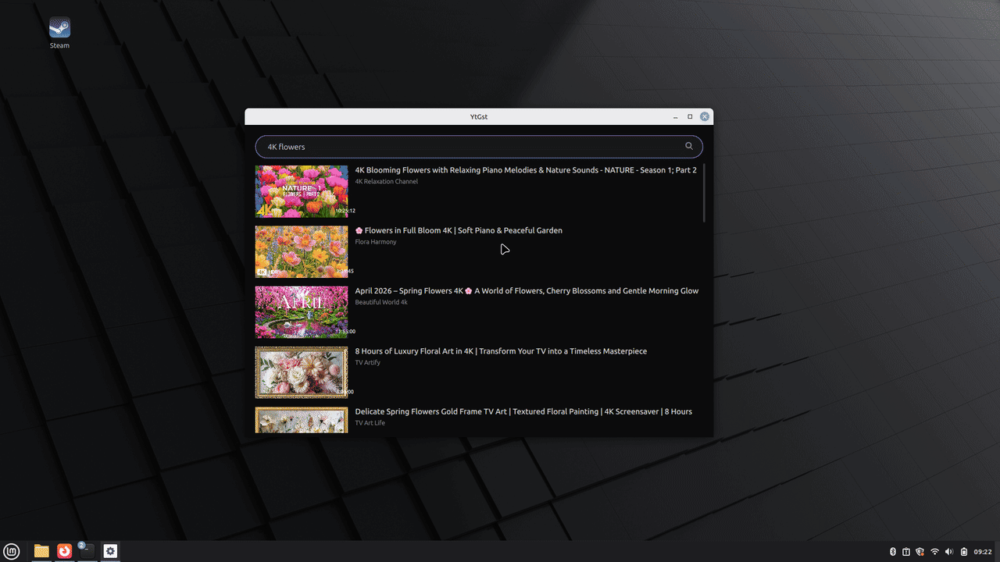
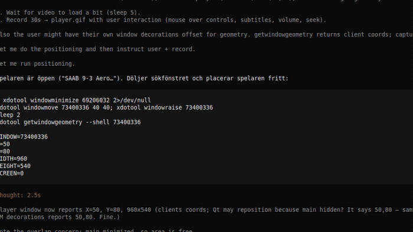

# YtGst

A lightweight YouTube player for Linux, with a **windowed player**: the picture
has a window of its own and the controls sit on a slidable, see-through panel on
top of it.

YtGst has three windows:

| Window | What it is |
| --- | --- |
| **YtGst** | The search window. Stays open while videos play. |
| **YtGst Player** (picture) | The picture, in a window with a frame you can drag and resize. |
| **The control panel** | A transparent strip with the controls, floating above the picture. |

The picture and the panel belong to a player process of their own, so the search
window is never blocked and a video can be closed without leaving the search.

It is built from three parts:

| Part | Role |
| --- | --- |
| **yt-dlp** | Fetches metadata, stream URLs and subtitles from YouTube |
| **GStreamer** | Decodes the picture and the sound |
| **Qt 6 / QML** | Draws the windows, the panel and the subtitles |

## Demos

| Searching | Playing |
| --- | --- |
|  |  |

## How it works

1. **Search.** `src/youtube.cpp` queries YouTube's internal "Innertube" API with
   Qt Network. The JSON reply is parsed into `VideoListModel`, which QML draws as
   video cards.
2. **Play.** Clicking a card starts a player process
   (`ytgst --play <video-id> --parent-pid <our-pid>`). It runs `yt-dlp -j` to get
   metadata, stream URLs and subtitle tracks, then builds one GStreamer pipeline
   with a video branch and an audio branch.
3. **Picture.** The video branch feeds `waylandsink`, which draws into the
   application's own window (`qml/VideoWindow.qml`). The sink is handed the
   window's Wayland surface, so the picture is a sub-surface of that window -
   which is what gives it a frame, dragging, resizing and fullscreen.
4. **Panel.** The control panel (`qml/PlayerWindow.qml`) is a separate,
   transparent window, and a **transient child of the picture window**. Weston
   stacks a child immediately in front of its parent and keeps the two in the
   same layer, so the controls stay above the picture - also in fullscreen.

```text
Search window "YtGst"
  │  click a video
  ▼
Player process
  ├── yt-dlp -j ─────────────► metadata + stream URLs (HLS / DASH) + subtitles
  │
  └── GStreamer pipeline (one clock, one set of seeks)
        ├── souphttpsrc → hlsdemux → tsdemux → queue (10 s)
        │     → h264parse → v4l2slh264dec → waylandsink ──► picture window
        └── souphttpsrc → hlsdemux → decodebin
              → audioconvert → audioresample → capsfilter (48 kHz S16LE stereo)
              → volume → pulsesink
```

The picture is **not** a playbin and **not** a GStreamer item inside the QML
scene: the sink draws straight into the window. The sound is not a playbin
either - both branches are explicit chains (see below).

The panel fades out after five seconds without the pointer, but the subtitles do
not: they live outside the part of the panel that fades.

## Rendering

- **Vulkan by default.** `src/main.cpp` picks the RHI backend after the
  application object exists: Vulkan when a Vulkan ICD is installed, otherwise
  OpenGL and OpenGL ES. `YTGST_RENDERER=opengl` (or `vulkan`) forces one.
- **Hardware video decoding.** The decoder is an explicit element in the chain,
  and its rank is raised at startup. On the STM32MP25 that is `v4l2slh264dec`
  (V4L2 stateless H.264); on a PC, `vah264dec` or `nvdec` can be configured.
- **No buffering queue from a playbin.** A playbin buffers its HTTP stream in a
  queue of its own and reports that buffering *into the pipeline it lives in*.
  On the target this held the whole pipeline back whenever the audio fell
  behind: a steady 30 fps dropped to 0 fps for seconds at a time. `decodebin`
  and `souphttpsrc` keep no such queue, and a measured 26 periods in a row ran
  at exactly 30.0 fps.
- **A window is never hidden.** Hiding a Qt window destroys its Wayland surface,
  and on the STM32MP25 the VeriSilicon Vulkan driver does not survive a surface
  that is created again. The picture window is therefore mapped once and stays
  mapped; closing the picture ends the player process instead. This is also why
  the panel is a transient child rather than a window that is shown and hidden.

## Requirements

Package names below are for Debian/Ubuntu-like systems.

**Build tools:** `cmake` (>= 3.16), `g++` (C++17), `pkg-config`.

**Qt 6.8 or newer** - core, network, declarative and (for the picture window's
frame) widgets, plus the QML modules for QtQuick and QtQuick.Controls.

**GStreamer 1.0** with these elements:

| Element | Package (Debian/Ubuntu) | Used for |
| --- | --- | --- |
| `souphttpsrc` | `gstreamer1.0-plugins-good` | Fetching the streams |
| `hlsdemux`, `tsdemux`, `qtdemux`, `decodebin` | `gstreamer1.0-plugins-good` / `-bad` | Demuxing and autoplugging |
| `h264parse`, `waylandsink` | `gstreamer1.0-plugins-bad` | Parsing, and the picture |
| `audioconvert`, `audioresample`, `volume` | `gstreamer1.0-plugins-base` | The sound |
| `v4l2slh264dec` | `gstreamer1.0-plugins-bad` (`v4l2codecs`) | Hardware decoding on the target |
| `pulsesink` (or `pipewiresink`) | `gstreamer1.0-pulseaudio` | The sound server |

Any decoder can be configured instead, for example `vah264dec` (`vainfo`/VA-API)
or `avdec_h264` (software).

**Runtime tools**

| Tool | Why |
| --- | --- |
| `yt-dlp` | Streams, metadata, subtitles |
| `ffmpeg` | Merging video + sound into the downloaded `.mp4` |

## Build and run

```bash
cmake -S . -B build -DCMAKE_BUILD_TYPE=Release
cmake --build build -j"$(nproc)"
./build/ytgst
```

Point CMake at a Qt that is not installed system-wide with
`-DCMAKE_PREFIX_PATH=/path/to/Qt/6.8.4/gcc_64`.

A build for the STM32MP25 board is a Yocto recipe (`bitbake ytgst`); it passes
`-DYTGST_VIDEO_DECODER=v4l2slh264dec` and depends on `ffmpeg`. Installing that
package on the board is all the application needs.

`cmake --install build` installs the executable; `qt_add_qml_module` compiles the
QML into the binary, so there is nothing else to install.

### Command line

| Argument | Meaning |
| --- | --- |
| *(none)* | The search window |
| `--play <video-id>` | Start a player for that video ID |
| `--play <id> --title <text>` | The same, with the title already set |
| `--watch <url>` | Play a YouTube URL directly, in a player of its own |
| `--parent-pid <pid>` | Exit when that process goes away |

`--parent-pid` is how the launcher makes sure no player (and no picture window)
is left behind when the search window is closed.

## Compile-time options

| Option | Default | Meaning |
| --- | --- | --- |
| `YTGST_YTDLP_PATH` | empty (auto) | Path to yt-dlp; empty = `PATH` |
| `YTGST_VIDEO_DECODER` | `vah264dec` | Video decoder named in the chain (`v4l2slh264dec`, `nvdec_h264`, ...) |
| `YTGST_AUDIO_DECODER` | empty (auto) | Raises the rank of an audio decoder, e.g. `avdec_aac` |
| `YTGST_AUDIO_SINK` | empty (auto) | Audio sink (`pulsesink`, `pipewiresink`, `alsasink`); empty = first that exists |
| `YTGST_VIDEO_SINK` | empty (`waylandsink name=gsink`) | Replaces the video sink chain |
| `YTGST_VAAPI_DRIVER` | empty (auto) | Value for `LIBVA_DRIVER_NAME`, e.g. `i965` or `iHD` |

Every one of them can also be overridden at runtime with an environment variable
of the same name, for a quick comparison without a rebuild.

## Runtime environment

| Variable | Effect |
| --- | --- |
| `YTGST_RENDERER=opengl\|vulkan` | Forces the RHI backend |
| `YTGST_DEBUG_FPS=1` | Prints how many buffers the video sink consumes per second, and the timestamp of every 120th buffer |
| `YTGST_NO_AUDIO=1` | Plays the picture alone, to tell a stutter the audio causes from one that is there anyway |
| `YTGST_HEIGHT=<px>` | Starts at that height instead of the 480p default (the resolution menu overrides it) |
| `YTGST_VIDEO_DECODER`, `YTGST_AUDIO_SINK`, `YTGST_VIDEO_SINK` | As the compile-time options above |

## Using the player

The panel holds, from the left: play/pause, speed, resolution, subtitles,
fullscreen, download, **panel size**, and on the right the volume and close.

- **Progress bar** across the top: click or drag to seek; a time bubble follows
  the pointer. It ends exactly at the panel's edge.
- **Resolution:** `Auto` or a fixed height. The choice applies to playback and to
  downloads; `Auto` takes the best stream the target can decode.
- **Subtitles:** the CC button lists every track (manual and automatic). White
  text on a black plate.
- **Panel size S / M / L / XL:** scales the whole panel proportionally - every
  margin, icon, font and the window itself. S is the original 720x140 strip, M is
  1.5x, L is 2x and XL is 2.5x. The scale is clamped to the screen width, so XL
  uses 2.5x on a 1920 pixel output and less on a smaller one.
- **Volume:** click the speaker for a horizontal slider, quiet on the left.
- **Fade:** after five seconds without the pointer the controls fade away; the
  subtitles stay. Moving the pointer over the panel brings them back.
- **Close:** the panel's X, the picture's X, `Esc` and closing the search window
  all end the player process (and with it both windows). Closing the search
  window closes every player.

### Keyboard shortcuts

| Key | Function |
| --- | --- |
| `M` | Mute on/off |
| `Up` / `Down` | Volume up / down |
| `D` | Start / cancel download |
| `F` or `F11` | Fullscreen on/off |
| `Esc` | Close the player |

The shortcuts are application-wide on purpose, so they also work while the
picture window has focus.

## Downloads

Click the download button (or press `D`) to download the current video.

- **Resolution:** the one selected in the panel. With `Auto`, the best stream.
- **Format:** one **`.mp4`** with **H.264 video and AAC sound**, so any player
  opens it. VP9/Opus or AV1 are accepted as fallbacks when a video has no H.264.
- **Folder:** the system download folder, normally `~/Downloads`; otherwise the
  movies folder, then the home directory.
- **File name:** `%(title)s [%(id)s].%(ext)s`.
- **Status:** "Downloading … %", then "Finishing the download …" while the two
  streams are merged, then "Download complete" for ten seconds. The button turns
  back into a download arrow when it is done.
- **Cancel:** click the button again (or press `D` again).

yt-dlp is run with approximately:

```text
--newline --no-warnings --no-playlist
-P <download folder>
-o "%(title)s [%(id)s].%(ext)s"
-f "bv*[vcodec^=avc1][height<=H]+ba[ext=m4a]/bv*[ext=mp4][height<=H]+ba[ext=m4a]/..."
--merge-output-format mp4 --remux-video mp4
<video URL>
```

**ffmpeg is required** - it is what merges the two streams. Without it yt-dlp
leaves the streams as separate files.

## Subtitles

Both **manual** subtitles (made by the channel) and **automatically generated or
translated** ones are supported.

1. When a video is loaded, all tracks are listed in the CC menu.
2. Picking a language fetches the subtitle into a per-language cache, so
   switching back and forth is fast.
3. Cues are parsed from YouTube's `json3` (preferred) or VTT and shown at the
   bottom of the panel, on a black plate with white text.

**Cookies from the browser.** YouTube requires an authenticated request for
automatically translated subtitles (otherwise `HTTP 429`). YtGst lets yt-dlp
fetch cookies from an installed browser (Firefox, Chromium, Chrome, Brave, Edge,
Vivaldi or Opera) when a video is loaded. They are written to a temporary file
that is read and deleted immediately; only `youtube.com` receives them. Without a
browser, manual subtitles still work.

## Project structure

```text
YtGst/
├── CMakeLists.txt          Build rules, dependencies and compile-time options
├── qml/
│   ├── Main.qml            Search window "YtGst", with its own frame
│   ├── PlayerWindow.qml    The control panel (transparent, scaled S-XL)
│   ├── VideoWindow.qml     The picture's window, with its frame and buttons
│   ├── SearchBar.qml       Search field
│   ├── VideoCard.qml       One video card in the list
│   └── Spinner.qml         Loading indicator
└── src/
    ├── main.cpp            Entry point, RHI backend, launcher, player process
    ├── player.cpp/.h       yt-dlp, both pipelines, subtitles, download, window embedding
    ├── youtube.cpp/.h      YouTube search (Innertube)
    ├── videomodel.cpp/.h   List model with video cards
    └── ytdlp.h             Locates yt-dlp (compiled path or PATH)
```

| File | Responsibility |
| --- | --- |
| `src/main.cpp` | Picks the graphics API, raises decoder ranks, runs the search window or a player, starts player processes and watches the parent process. |
| `src/player.*` | Fetches metadata with yt-dlp, builds the video and audio chains, embeds the sink in the picture window, and handles play/pause, seek, speed, resolution, volume, subtitles and downloads. |
| `src/youtube.*` | Sends search and continuation requests to YouTube's internal API and parses the JSON. |
| `src/videomodel.*` | A `QAbstractListModel` holding the video list. |
| `qml/Main.qml` | Search field, list, error messages and the window frame. |
| `qml/PlayerWindow.qml` | The panel: seek bar, play/pause, speed, resolution, subtitles, fullscreen, download, panel size, volume and close. |
| `qml/VideoWindow.qml` | The picture's window: title bar, drag, resize, fullscreen and close. |

## Troubleshooting

**No sound.** Check the sound server and the sink's volume first:

```bash
pactl list sinks | grep -E "Name:|Mute:|Volume"
gst-launch-1.0 audiotestsrc num-buffers=430 samplesperbuffer=1024 \
  ! audioconvert ! audioresample ! pulsesink     # about 9 seconds of tone
```

If the tone is audible, the output is fine. `YTGST_DEBUG_FPS=1` then tells you
whether the picture and the sound keep up; `YTGST_NO_AUDIO=1` plays the picture
alone.

**The window freezes or the compositor dies.** Almost always the graphics driver
running out of memory. A large control panel (XL) plus a video is the heaviest
case; the panel scale is clamped to the screen width, but a driver with a small
carve-out can still be pushed too far - use a smaller panel size. Look for
`core0 hang` or `cma_alloc ... failed` in `dmesg`.

**Black picture, or the player exits immediately.** Check the decoder:

```bash
gst-inspect-1.0 v4l2slh264dec      # or the decoder you configured
YTGST_DEBUG_FPS=1 ./build/ytgst --watch <url>
```

**Streaming stutters.** Make sure the platform's hardware decoder is the one in
use; a software H.264 decoder on a small CPU cannot keep up with 1080p. Also
check that nothing else competes for the GPU.

**Downloads stay as two files.** Install `ffmpeg` - yt-dlp needs it to merge.

## Known limitations

- **A window must never be hidden** (see Rendering); the design keeps every
  window mapped for the whole session instead.
- **H.264 on the target.** The STM32MP25 VPU decodes H.264 (and VP8); VP9/AV1
  are decoded in software, which is far too slow at 1080p, so streams are pinned
  to H.264 where that is the case.
- **HLS is preferred** over DASH because GStreamer can seek in it; some high
  resolutions may only exist as DASH.
- **Subtitles may require signing in** (cookies) to YouTube.
- **Network is always required.** Neither search nor playback works offline.
- **yt-dlp must be reasonably up to date**, since YouTube changes often.
